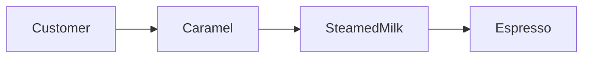

# Guide 09 — Decorator

**Lab:** [Requirements](../../phases/phase-09/requirements.md) · [Guided check](../../phases/phase-09/guided-check.md) · [Questions](../../phases/phase-09/questions.md)

## Chapter 9: "Add-ons at DailyPour"

A customer orders an espresso at **DailyPour**. The cup has one method: `Beverage.serve() -> Cup`. Add-ons—steamed milk, caramel—should wrap that same drink. The first design subclasses `MilkEspresso` and `CaramelEspresso`. Milk plus caramel would need yet another subclass.

You need **Decorator**: wrap a component with the same interface, stacking behaviors without a class combinatorial nightmare.

_Head First Design Patterns_ Chapter 3. Refactoring Guru: attach new behaviors with wrapper objects ([Decorator](https://refactoring.guru/design-patterns/decorator)).

---

## Learning Objectives

By the end of this guide you will be able to:

- State Decorator’s intent
- Stack cross-cutting behaviors without inheritance explosion
- Reason about wrapper order
- Bridge the idea to Phase 9 without copying DailyPour types

---

## Theory

### Intent

**Decorator** attaches additional responsibilities to an object dynamically. Decorators provide a flexible alternative to subclassing for extending functionality. Each decorator implements the same interface as the component it wraps, delegates to an inner object, and adds behavior before or after the call.

_Head First Design Patterns_ covers Decorator in Chapter 3 (the classic coffee example). Refactoring Guru: stack wrappers instead of multiplying subclasses ([Decorator](https://refactoring.guru/design-patterns/decorator)).

### The problem in plain language

Cross-cutting concerns—logging, retries, timeouts, metrics, authorization—apply to many operations. Subclassing for every combination leads to **combinatorial explosion**. Copy-paste between subclasses drifts. Removing one concern from a stack of inherited classes is painful.

You need to add behavior **without changing the core component** and **without a new subclass per combination**.

### Analogy — coffee shop add-ons

You order a simple espresso. Add-ons—extra shot, steamed milk, caramel—wrap the drink: each add-on presents the same “beverage” interface to the cashier and passes the order inward, adding cost and preparation steps. You can stack milk + caramel without inventing a `MilkCaramelEspresso` subclass for every permutation.

Decorators are those add-on wrappers for code: same `Beverage.serve()` interface, extra behavior around the inner cup.

### Solution structure

| Role                    | Responsibility                              | In Phase 9 lab             |
| ----------------------- | ------------------------------------------- | -------------------------- |
| **Component**           | Core interface                              | `ActuatorPort`             |
| **Concrete component**  | Base behavior                               | Raw actuator adapter       |
| **Decorator**           | Implements component; holds inner reference | `LoggingActuatorDecorator` |
| **Concrete decorators** | Specific cross-cutting policy               | max runtime, execution log |

Stack at composition root: `MaxRuntimeDecorator(LoggingDecorator(real_actuator))`. **Order matters**—logging outside retry sees every attempt; max runtime outside everything caps total wall time.

### How collaboration works



Each layer calls `inner.serve()`, then adds its own step.

### When to use / when to skip

**Use Decorator when:**

- Multiple optional behaviors combine around a stable interface.
- You want to add/remove policies at runtime or per environment.
- Subclassing would explode combinations.

**Skip or simplify when:**

- One behavior applies everywhere—a single well-placed function or middleware is simpler.
- Wrappers must change the method signature—that is Adapter territory.
- Debugging stacked wrappers becomes opaque—document order and keep stacks shallow.

### Related patterns

- **Adapter** — changes interface; Decorator **keeps** interface and adds behavior.
- **Chain of Responsibility** — passes along a chain until someone handles; Decorator **always** delegates through the full stack.
- **Proxy** — controls access (lazy load, remote); structurally similar wrapper, different intent.
- **Builder** — functionally almost identical, but the purpose is difference. Builder focuses on how an object is constructed, typically step by step and decorator focuses on how and object's behavior is extended without modifying its original class.

---

# Part 2 — Follow along

> **Follow along:** Stdlib Python only. Run the problem demo first, then the complete decorator stack.

## 1. The sticky problem

Same morning. The customer is at the counter. There are no wrappers, so each add-on is a new drink class.

### 1.1 Smell: a subclass for every pairing

```python
# Milk plus caramel wants yet another subclass. The pairings multiply.
class MilkCaramelEspresso(Espresso):
    ...  # copy-paste from MilkEspresso and CaramelEspresso
```

**Root cause:** Behavior combinations grow exponentially with inheritance.

### 1.2 Runnable problem demo

> **Follow along:** Save as `dailypour_before.py`, run `python dailypour_before.py`.

```python
"""Monday morning at DailyPour. Each add-on is its own subclass."""


class Espresso:
    """Concrete component. A plain shot, still trapped under subclasses."""

    def serve(self) -> str:
        return "espresso"


class MilkEspresso(Espresso):
    def serve(self) -> str:
        # The subclass owns the whole drink. It cannot be stacked with caramel.
        print("The milk subclass steams milk, then pulls the shot.")
        return "Espresso with steamed milk — 2.50 EUR"


class CaramelEspresso(Espresso):
    def serve(self) -> str:
        print("The caramel subclass drizzles caramel, then pulls the shot.")
        return "Espresso with caramel — 2.70 EUR"


if __name__ == "__main__":
    print("A customer orders an espresso.")
    print(MilkEspresso().serve())
    print(CaramelEspresso().serve())
    print("PAIN: milk plus caramel wants another subclass")
```

**Expected output (problem):**

```text
A customer orders an espresso.
The milk subclass steams milk, then pulls the shot.
Espresso with steamed milk — 2.50 EUR
The caramel subclass drizzles caramel, then pulls the shot.
Espresso with caramel — 2.70 EUR
PAIN: milk plus caramel wants another subclass
```

### What goes wrong when requirements change

Add an extra shot and the subclasses multiply. The order of milk and caramel becomes inconsistent across the counter.

---

## 2. Pattern in practice

The add-ons leave the subclasses. Each one wraps the same cup. The counter stacks them.

---

## 3. Building the solution (step by step)

### Step A — One drink interface, and a wrapper that holds the inner cup

```python
class BeverageDecorator(Beverage):
    def __init__(self, inner: Beverage) -> None:
        self._inner = inner  # wrap the cup; do not subclass every pairing

    def serve(self) -> Cup:
        return self._inner.serve()
```

### Step B — One add-on per wrapper

```python
class SteamedMilk(BeverageDecorator):
    def serve(self) -> Cup:
        cup = super().serve()  # the inner drink finishes first
        print("Milk steams into the cup.")
        return Cup(f"{cup.name}, steamed milk", cup.price_eur + Decimal("0.50"))
```

### Step C — The counter stacks the wrappers

```python
drink: Beverage = Espresso()
drink = SteamedMilk(drink)
drink = Caramel(drink)  # outermost finishes last
```

---

## 4. Complete worked solution (runnable)

> **Follow along:** Save as `dailypour_decorator.py`, run `python dailypour_decorator.py`.

```python
"""Later that morning. Two add-ons, one espresso (stdlib only)."""

from abc import ABC, abstractmethod
from dataclasses import dataclass
from decimal import Decimal


@dataclass(frozen=True)
class Cup:
    name: str
    price_eur: Decimal


class Beverage(ABC):
    """Component. Every add-on presents this same serve()."""

    @abstractmethod
    def serve(self) -> Cup:
        ...


class Espresso(Beverage):
    """Concrete component. The shot itself. It does not know about add-ons."""

    def serve(self) -> Cup:
        print("The barista pulls an espresso.")
        return Cup("espresso", Decimal("2.00"))


class BeverageDecorator(Beverage):
    """Decorator. Holds the inner drink and keeps the same interface."""

    def __init__(self, inner: Beverage) -> None:
        self._inner = inner

    def serve(self) -> Cup:
        return self._inner.serve()


class SteamedMilk(BeverageDecorator):
    """One add-on. It steams after the inner cup, then adds 0.50."""

    def serve(self) -> Cup:
        cup = super().serve()
        print("Milk steams into the cup.")
        return Cup(f"{cup.name}, steamed milk", cup.price_eur + Decimal("0.50"))


class Caramel(BeverageDecorator):
    """One add-on. Outside the milk, so the drizzle finishes last."""

    def serve(self) -> Cup:
        cup = super().serve()
        print("Caramel drizzles on top.")
        return Cup(f"{cup.name}, caramel", cup.price_eur + Decimal("0.70"))


def order() -> Beverage:
    """Composition root. The counter stacks wrappers; the classes stay single-purpose."""
    drink: Beverage = Espresso()
    drink = SteamedMilk(drink)
    return Caramel(drink)


if __name__ == "__main__":
    print("The customer orders again.")
    cup = order().serve()
    print(f"{cup.name} — {cup.price_eur} EUR")
```

**Expected output (solution):**

```text
The customer orders again.
The barista pulls an espresso.
Milk steams into the cup.
Caramel drizzles on top.
espresso, steamed milk, caramel — 3.20 EUR
```

Caramel sits outside steamed milk, so the drizzle prints last. Swap the wrappers and the finish order swaps.

---

## 5. Compare & contrast

|           | Decorator                 | Adapter (Guide 05)            |
| --------- | ------------------------- | ----------------------------- |
| Interface | Same as wrapped component | Different (target vs adaptee) |
| Goal      | Add responsibilities      | Make incompatible APIs work   |

---

## 6. Watch out for these traps

- Decorators that change the interface “a little”
- Ignoring call order
- Copying DailyPour names into the actuator lab

---

## 7. Try this

Wrap so `SteamedMilk` is outside `Caramel`. Re-run. Milk should print after the drizzle. Neither add-on class changes. Only the stack at the counter changes.

---

## Key Terms

| Term            | Definition                                                        |
| --------------- | ----------------------------------------------------------------- |
| **Decorator**   | Structural pattern that wraps a component with the same interface |
| **Composition** | Building behavior by wrapping rather than subclassing             |

---

## Reading Assignments

**Required:**

- _Head First Design Patterns_ — Chapter 3
- [Refactoring Guru — Decorator](https://refactoring.guru/design-patterns/decorator)
- Lab: [Requirements](../../phases/phase-09/requirements.md) · [Guided check](../../phases/phase-09/guided-check.md) · [Questions](../../phases/phase-09/questions.md)

---

## Bridge to your lab

Phase 9 stacks cross-cutting policies around an actuator port. Wire the stack in composition roots.

| Teaching (this guide)     | Your lab (greenhouse)                                     |
| ------------------------- | --------------------------------------------------------- |
| `Beverage.serve`          | `ActuatorPort` (`apply`)                                  |
| `Espresso`                | Simulation (or vendor) actuator adapter                   |
| `SteamedMilk` / `Caramel` | Logging decorator; max-run-time (or lab) policy decorator |
| Wrapper order             | Logging outermost vs policy inner — document it           |
| Console lines             | `actuator_execution_log` rows                             |

**Do / don’t:** **Do** compose wrappers that share one interface; order matters. **Don’t** nest `if policy` in the router, and don’t give each decorator a different method name.

---

## Summary

- Inheritance combinations explode when cross-cutting behaviors multiply.
- Decorator stacks wrappers that share one interface.
- Mind wrapper order—it changes observable behavior.

**Next:** [Guide 10 — Command](./10-command.md)
