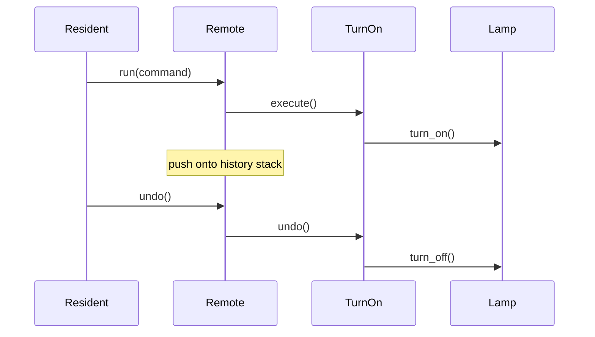

# Guide 10 — Command

**Lab:** [Requirements](../../phases/phase-10/requirements.md) · [Guided check](../../phases/phase-10/guided-check.md) · [Questions](../../phases/phase-10/questions.md)

## Chapter 10: "Undo at GlowTap"

Evening. **GlowTap** is one smart hall lamp. `Lamp.turn_on()` and `Lamp.turn_off()` change whether it is lit. The first build calls those methods directly, so nothing can reverse the last switch.

You need the **Command** pattern: turn each request into an object that can `execute()` and `undo()`.

*Head First Design Patterns* Chapter 6. Refactoring Guru: ([Command](https://refactoring.guru/design-patterns/command)).

---

## Learning Objectives

By the end of this guide you will be able to:

- Explain Command as an objectified request
- Implement execute/undo with a history stack
- Contrast Command with a plain method call and with Strategy
- Bridge the idea to Phase 10 without copying GlowTap types

---

## Theory

### Intent

**Command** encapsulates a request as an object, thereby letting you parameterize clients with different requests, queue operations, and support undo. The command object knows how to `execute()` the action and often how to `undo()` it. An **invoker** triggers commands; a **receiver** holds the state that changes.

*Head First Design Patterns* covers Command in Chapter 6 (remote control metaphor). Refactoring Guru: turn requests into objects ([Command](https://refactoring.guru/design-patterns/command)).

### The problem in plain language

Direct method calls (`lamp.turn_on()`) are ephemeral—no record of what happened, no queue, no undo stack, no audit trail. When operators need **history**, **retry**, or **macro playback**, the caller must remember parameters and inverse operations scattered across the UI and services.

Actuator control has the same shape: “turn on pump 3” should be loggable, reversible where safe, and compatible with State guards.

### Analogy — a smart-home remote

You do not rewire the hall lamp every time you want it on. You press a button on a remote. That button is a request the remote can keep: Undo runs the last presses backward. `Remote.run` calls `execute()`, keeps the command, and `undo()` asks the lamp to reverse.

### Solution structure

| Role | Responsibility | In Phase 10 lab |
| ---- | -------------- | --------------- |
| **Command** | `execute()` / `undo()` (optional) | `StartActuatorCommand`, … |
| **Receiver** | Domain object that changes | `ActuatorContext`, hardware port |
| **Invoker** | Runs commands; may keep history | `CommandInvoker` |
| **Client** | Creates commands; passes to invoker | API handler, UI button |

Persist `command_log` for audit; integrate with State so illegal commands fail before execute.

### How collaboration works



### When to use / when to skip

**Use Command when:**

- Operations need **undo**, **redo**, **queue**, or **audit history**.
- You want to decouple “who triggers” from “what runs” (buttons, API, scheduler, macros).
- Commands compose with State (legal check) and Decorator (logged execution).

**Skip or simplify when:**

- Actions are fire-and-forget with no history requirement—a direct method call is fine.
- Undo is impossible or dangerous (send email)—log intent without reversible commands.
- Every command would be a one-liner wrapper—consider whether history truly matters.

### Related patterns

- **Strategy** — encapsulates algorithms; Command encapsulates **requests with side effects**. Strategy answers “how to compute”; Command answers “do this, remember it, maybe undo.”
- **Memento** — stores receiver state for undo; Command can embed memento data or inverse operations.
- **State** — commands trigger transitions; State decides legality before execute runs.

---

# Part 2 — Follow along

> **Follow along:** Stdlib Python only. Run the problem demo first, then the complete command script.

## 1. The sticky problem

Same evening. The resident is in the hall. The switch is a direct call, so nothing remembers it.

### 1.1 Smell: a switch with no memory

```python
# The lamp changes, and the request itself is gone.
lamp.turn_on()  # how do we undo?
```

**Root cause:** Invocations are not first-class objects.

### 1.2 Runnable problem demo

> **Follow along:** Save as `glowtap_before.py`, run `python glowtap_before.py`.

```python
"""Evening at GlowTap. The switch is a direct call."""


class Lamp:
    """Receiver. It only knows how to light or go dark."""

    def __init__(self) -> None:
        self.on = False

    def turn_on(self) -> None:
        self.on = True
        print("The hall lamp is lit.")

    def turn_off(self) -> None:
        self.on = False
        print("The hall lamp is dark.")


if __name__ == "__main__":
    lamp = Lamp()
    print("Evening at GlowTap. The hall lamp is dark.")
    lamp.turn_on()  # nothing stored the request
    print("PAIN: no history — cannot undo the switch")
```

**Expected output (problem):**

```text
Evening at GlowTap. The hall lamp is dark.
The hall lamp is lit.
PAIN: no history — cannot undo the switch
```

### What goes wrong when requirements change

Audit logs, queues, and undo all need a *request object*. Plain method calls give you none of that.

---

## 2. Pattern in practice

The switch becomes a command. The remote runs it and keeps it. Undo asks the lamp to reverse.

---

## 3. Building the solution (step by step)

### Step A — A request with execute and undo

```python
class Command(ABC):
    @abstractmethod
    def execute(self) -> None:
        """Do the switch."""
        ...

    @abstractmethod
    def undo(self) -> None:
        """Reverse that same switch."""
        ...
```

### Step B — TurnOn calls the lamp

```python
class TurnOn(Command):
    def __init__(self, lamp: Lamp) -> None:
        self._lamp = lamp  # the command holds the receiver

    def execute(self) -> None:
        self._lamp.turn_on()

    def undo(self) -> None:
        self._lamp.turn_off()  # the opposite switch
```

### Step C — The remote keeps a history

```python
class Remote:
    def run(self, command: Command) -> None:
        command.execute()
        self._history.append(command)  # invoker, not the lamp, remembers
```

---

## 4. Complete worked solution (runnable)

> **Follow along:** Save as `glowtap_command.py`, run `python glowtap_command.py`.

```python
"""Later that evening. Two switches, one remote (stdlib only)."""

from abc import ABC, abstractmethod


class Lamp:
    """Receiver. The lamp changes. It does not remember who asked."""

    def __init__(self) -> None:
        self.on = False

    def turn_on(self) -> None:
        self.on = True
        print("The hall lamp is lit.")

    def turn_off(self) -> None:
        self.on = False
        print("The hall lamp is dark.")


class Command(ABC):
    """Command. A request the remote can run and later reverse."""

    @abstractmethod
    def execute(self) -> None:
        ...

    @abstractmethod
    def undo(self) -> None:
        ...


class TurnOn(Command):
    def __init__(self, lamp: Lamp) -> None:
        self._lamp = lamp

    def execute(self) -> None:
        self._lamp.turn_on()

    def undo(self) -> None:
        self._lamp.turn_off()


class TurnOff(Command):
    def __init__(self, lamp: Lamp) -> None:
        self._lamp = lamp

    def execute(self) -> None:
        self._lamp.turn_off()

    def undo(self) -> None:
        self._lamp.turn_on()


class Remote:
    """Invoker. It runs a command and keeps it for undo."""

    def __init__(self) -> None:
        self._history: list[Command] = []

    def run(self, command: Command) -> None:
        command.execute()
        self._history.append(command)

    def undo(self) -> None:
        if not self._history:
            return
        print("Undo.")
        self._history.pop().undo()


if __name__ == "__main__":
    lamp = Lamp()
    remote = Remote()
    print("The resident picks up the remote.")
    remote.run(TurnOn(lamp))
    remote.run(TurnOff(lamp))
    remote.undo()
    remote.undo()
    print("The remote remembered both switches.")
```

**Expected output (solution):**

```text
The resident picks up the remote.
The hall lamp is lit.
The hall lamp is dark.
Undo.
The hall lamp is lit.
Undo.
The hall lamp is dark.
The remote remembered both switches.
```

---

## 5. Watch out for these traps

- Commands that bypass State guards
- Forgetting to store undo data before mutating
- Pasting GlowTap classes into pump handlers

---

## 6. Try this

The hall lamp can dim. Add `SetBrightness` that remembers the previous level before changing it, then one undo restores that level. `Remote.run` and `Remote.undo` stay unchanged.

---

## Key Terms

| Term | Definition |
|------|------------|
| **Command** | Object representing a request to perform (and often undo) |
| **Invoker** | Triggers commands without knowing receivers in detail |
| **Receiver** | Object that performs the actual work |
| **History stack** | Sequence of executed commands for undo/redo |

---

## Reading Assignments

**Required:**

- *Head First Design Patterns* — Chapter 6
- [Refactoring Guru — Command](https://refactoring.guru/design-patterns/command)
- Lab: [Requirements](../../phases/phase-10/requirements.md) · [Guided check](../../phases/phase-10/guided-check.md) · [Questions](../../phases/phase-10/questions.md)

---

## Bridge to your lab

Phase 10 turns operator actions into commands that respect State and may run through decorated ports, with an audit trail.

| Teaching (this guide) | Your lab (greenhouse) |
| --------------------- | --------------------- |
| `TurnOn` / `TurnOff` | `StartPumpCommand` / `StopPumpCommand` (lab types) |
| `Command.execute()` / `undo()` | `execute()` required; undo is optional extra |
| `Remote` invoker | `CommandInvoker.submit` |
| Lamp switch | Guard → decorated `ActuatorPort` → state transition → `command_log` |

**Do / don’t:** **Do** reject illegal-state commands in the domain and still persist `status=rejected`. **Don’t** implement start/stop in the router with `if command_type ==`, and don’t skip the Phase 9 port stack.

---

## Summary

- Bare method calls are hard to queue, log, and undo.
- Command makes requests objects with `execute` / `undo`.
- Combine with State so illegal actions fail in the domain.

**Next:** [Guide 11 — Observer](./11-observer.md)
